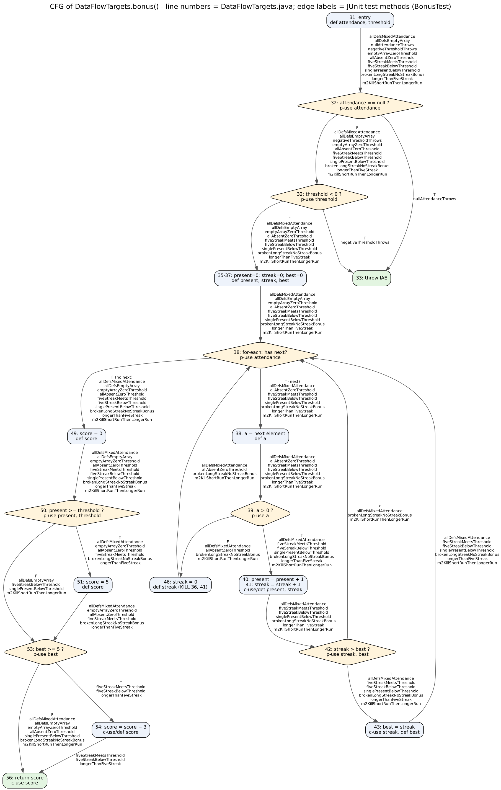

# Лаб 10: Өгөгдлийн урсгалын тест — Definition-Use хосууд

**Нэр:** М. Батдорж  
**Оюутны код:** B252270136

## Орчин

```
openjdk version "17.0.21.0.3" 2026-10-24
OpenJDK Runtime Environment (build 17.0.21.0.3+1-1-26.04.1-Ubuntu)
OpenJDK 64-Bit Server VM (build 17.0.21.0.3+1-1-26.04.1-Ubuntu, mixed mode, sharing)
```

```
Apache Maven 3.9.12
Maven home: /usr/share/maven
Java version: 17.0.21.0.3, vendor: Ubuntu, runtime: /usr/lib/jvm/java-17-openjdk-amd64
Default locale: en_US, platform encoding: UTF-8
OS name: "linux", version: "7.0.0-38-generic", arch: "amd64", family: "unix"
```

Мөрийн дугаарууд бүгд `src/main/java/mn/edu/must/sqat/DataFlowTargets.java` (starter-тэй ижил, өөрчлөөгүй) файлынх.

---

## Хэсэг A: gcd (мөр 13–21)

### Def / Use

| Мөр | Код | def | c-use | p-use |
|---|---|---|---|---|
| 13 | `gcd(int x, int y)` | x, y | | |
| 14 | `int tmp;` | — (зөвхөн зарлалт, утга оноогоогүй тул def биш) | | |
| 15 | `while (y != 0)` | | | y |
| 16 | `tmp = x % y;` | tmp | x, y | |
| 17 | `x = y;` | x | y | |
| 18 | `y = tmp;` | y | tmp | |
| 20 | `return x;` | | x | |

### DU хосууд (бүрэн)

| ID | Хувьсагч | Def мөр | Use мөр | Төрөл | Def-clear зам | Тестийн ID | Хамрагдсан |
|---|---|---|---|---|---|---|---|
| G1 | x | 13 | 16 | c-use | 13→15(T)→16 | G-T2 | ✔ |
| G2 | x | 13 | 20 | c-use | 13→15(F)→20 | G-T1 | ✔ |
| G3 | x | 17 | 16 | c-use | 17→18→15(T)→16 (≥2 давталт) | G-T2 | ✔ |
| G4 | x | 17 | 20 | c-use | 17→18→15(F)→20 | G-T2, G-T3 | ✔ |
| G5 | y | 13 | (15,T) | p-use | 13→15(T) | G-T2, G-T3 | ✔ |
| G6 | y | 13 | (15,F) | p-use | 13→15(F) | G-T1 | ✔ |
| G7 | y | 13 | 16 | c-use | 13→15(T)→16 | G-T2, G-T3 | ✔ |
| G8 | y | 13 | 17 | c-use | 13→15(T)→16→17 | G-T2, G-T3 | ✔ |
| G9 | y | 18 | (15,T) | p-use | 18→15(T) (≥2 давталт) | G-T2 | ✔ |
| G10 | y | 18 | (15,F) | p-use | 18→15(F) | G-T2, G-T3 | ✔ |
| G11 | y | 18 | 16 | c-use | 18→15(T)→16 (≥2 давталт) | G-T2 | ✔ |
| G12 | y | 18 | 17 | c-use | 18→15(T)→16→17 (≥2 давталт) | G-T2 | ✔ |
| G13 | tmp | 16 | 18 | c-use | 16→17→18 | G-T2, G-T3 | ✔ |

Нийт 13 хос, бүгд биелэх боломжтой, бүгд хамрагдсан. Kill: x-ийн def 13-ыг мөр 17, y-ийн def 13-ыг мөр 18 алдаг. tmp-ийн def 16 давталтын дараа хэрэглэгддэггүй (16→20 хос байхгүй).

### Тестүүд (`GcdTest.java`)

| Тестийн ID | Метод | Оролт → гаралт | Хамрах хосууд |
|---|---|---|---|
| G-T1 | `gcdYZeroSkipsLoop` | gcd(7,0) = 7 | G2, G6 |
| G-T2 | `gcdTwoIterations` | gcd(12,8) = 4 | G1, G3, G4, G5, G7–G13 |
| G-T3 | `gcdOneIterationXZero` | gcd(0,5) = 5 | G4, G5, G7, G8, G10, G13 (нэмэлт хилийн тохиолдол) |

**gcd(7,0) ганцаараа юуг хамардаг вэ?** y = 0 үед давталт огт ажиллахгүй, тиймээс зөвхөн 13→15(F)→20 замаар явдаг G2 (x 13→20) ба G6 (y 13→(15,F)) хосыг хамардаг. y ≠ 0 тест бүр давталт руу орох тул эдгээр хоёр хосыг өөр ямар ч тест хамарч чадахгүй.

**gcd(12,8) хэдэн давталт хийдэг вэ?** 2 давталт: (12,8) → tmp=4, x=8, y=4; (8,4) → tmp=0, x=4, y=0; дараа нь 15(F). Давталтын 2 дахь эргэлт шаарддаг хосууд: G3 (x 17→16), G9 (y 18→(15,T)), G11 (y 18→16), G12 (y 18→17) — мөр 17/18-ийн def нь буцаж 15/16/17-д хэрэглэгдэх ёстой.

---

## Хэсэг B: bonus (мөр 31–57)

### B1 — CFG



Зангилаа бүр файлын мөрийн дугаартай; мөр 32-ын `||` нь short-circuit тул хоёр шийдвэрийн зангилаа (32a: `attendance == null`, 32b: `threshold < 0`) болгосон. Мөр 38-ын for-each: нөхцөл = attendance-д дараагийн элемент байгаа эсэх (p-use attendance), алхам = дараагийн элементийг a-д оноох (def a). Ирмэг бүрд түүнийг дайрдаг `BonusTest`-ийн методын нэрийг бичсэн.

### B2 — Def/Use жагсаалт

```java
31: bonus(int[] attendance, int threshold)  // def: attendance, threshold
32: if (attendance == null || threshold < 0) // p-use: attendance, threshold (threshold нь attendance != null үед л)
33: throw new IllegalArgumentException(...)  // def/use байхгүй
35: int present = 0;                         // def: present
36: int streak = 0;                          // def: streak
37: int best = 0;                            // def: best
38: for (int a : attendance)                 // p-use: attendance (дараагийн элемент бий юу); def: a
39: if (a > 0)                               // p-use: a
40: present = present + 1;                   // c-use: present; def: present
41: streak = streak + 1;                     // c-use: streak; def: streak
42: if (streak > best)                       // p-use: streak, best
43: best = streak;                           // c-use: streak; def: best
46: streak = 0;                              // def: streak (KILL: 36, 41)
49: int score = 0;                           // def: score
50: if (present >= threshold)                // p-use: present, threshold
51: score = 5;                               // def: score (KILL: 49)
53: if (best >= 5)                           // p-use: best
54: score = score + 3;                       // c-use: score; def: score (KILL: 49, 51)
56: return score;                            // c-use: score
```

### B3 — DU хүснэгт

Тестийн ID: AD1–AD2 = all-defs шат, DU1–DU9 = all-DU-pairs шат (`BonusTest.java`-ийн `@DisplayName`-ийн эхэнд).

| ID | Хувьсагч | Def | Use | Төрөл | Def-clear зам (жишээ) | Тестийн ID | Хамрагдсан |
|---|---|---|---|---|---|---|---|
| P1 | attendance | 31 | (32a,T) | p | 31→32a(T)→33 | DU1 | ✔ |
| P2 | attendance | 31 | (32a,F) | p | 31→32a(F) | AD1, AD2 … | ✔ |
| P3 | attendance | 31 | (38,T) | p | 31→32→35–37→38(T) | AD1 | ✔ |
| P4 | attendance | 31 | (38,F) | p | 31→…→38(F) | AD1, AD2 | ✔ |
| P5 | threshold | 31 | (32b,T) | p | 31→32a(F)→32b(T)→33 | DU2 | ✔ |
| P6 | threshold | 31 | (32b,F) | p | 31→32a(F)→32b(F) | AD1 | ✔ |
| P7 | threshold | 31 | (50,T) | p | 31→…→50(T) | AD1, DU3, DU5 | ✔ |
| P8 | threshold | 31 | (50,F) | p | 31→…→50(F) | AD2, DU6 | ✔ |
| P9 | present | 35 | 40 | c | 35→38(T)→39(T)→40 (эхний ирц) | AD1 | ✔ |
| P10 | present | 35 | (50,T) | p | 35→38(F)→49→50(T): ирц 0, threshold=0 | DU3, DU4 | ✔ |
| P11 | present | 35 | (50,F) | p | 35→38(F)→49→50(F) | AD2 | ✔ |
| P12 | present | 40 | 40 | c | 40→…→38→39(T)→40 (2 дахь ирц) | AD1, DU5 | ✔ |
| P13 | present | 40 | (50,T) | p | 40→…→38(F)→49→50(T) | AD1, DU5 | ✔ |
| P14 | present | 40 | (50,F) | p | 40→…→38(F)→49→50(F) | DU6, DU7 | ✔ |
| P15 | streak | 36 | 41 | c | 36→38→39(T)→40→41 (эхний элемент ирсэн) | AD1, DU5 | ✔ |
| P16 | streak | 41 | 41 | c | 41→42→43→38→39(T)→40→41 (дараалсан ирц) | DU5 | ✔ |
| P17 | streak | 41 | (42,T) | p | 41→42(T) | AD1, DU5 | ✔ |
| P18 | streak | 41 | (42,F) | p | 41→42(F): streak ≤ best | AD1, DU8 | ✔ |
| P19 | streak | 41 | 43 | c | 41→42(T)→43 | AD1, DU5 | ✔ |
| P20 | streak | 46 | 41 | c | 46→38→39(T)→40→41 | AD1, DU8 | ✔ |
| P21 | best | 37 | (42,T) | p | 37→38→39(T)→40→41→42(T) | AD1, DU5 | ✔ |
| P22 | best | 37 | (53,F) | p | 37→38(F)→49→50→53(F) | AD2, DU3, DU4 | ✔ |
| P23 | best | 43 | (42,T) | p | 43→38→…→42(T) | DU5 | ✔ |
| P24 | best | 43 | (42,F) | p | 43→38→…→42(F) | AD1, DU8 | ✔ |
| P25 | best | 43 | (53,T) | p | 43→…→53(T) | DU5, DU6 | ✔ |
| P26 | best | 43 | (53,F) | p | 43→…→53(F) | AD1, DU7 | ✔ |
| P27 | score | 49 | 54 | c | 49→50(F)→53(T)→54 | DU6 | ✔ |
| P28 | score | 49 | 56 | c | 49→50(F)→53(F)→56 | AD2, DU7 | ✔ |
| P29 | score | 51 | 54 | c | 51→53(T)→54 | DU5 | ✔ |
| P30 | score | 51 | 56 | c | 51→53(F)→56 | AD1, DU3 | ✔ |
| P31 | score | 54 | 56 | c | 54→56 | DU5, DU6 | ✔ |
| P32 | a | 38 | (39,T) | p | 38→39(T) | AD1 | ✔ |
| P33 | a | 38 | (39,F) | p | 38→39(F) | AD1, DU4 | ✔ |
| X1 | best | 37 | (42,F) | p | — | — | биелэшгүй |
| X2 | best | 37 | (53,T) | p | — | — | биелэшгүй |

Нийт: 33 биелэх DU хос (бүгд хамрагдсан) + 2 биелэшгүй.

**Мөр 46-ийн `streak = 0`-ийн kill:** streak-ийн def 36 болон def 41-ийг алдаг. Тиймээс P15 (36→41) зөвхөн 46-г дайраагүй замаар (эхний элемент ирсэн) def-clear болно — `[0,1]` оролт энэ хосыг хамрахгүй, харин P20 (46→41)-ийг хамарна. Мөн def 41-ийн утга 46-д алагдсаны дараа 41→41 хос тасарна.

**Kill-ээр тасардаг тул DU хос гэж тоолоогүй хослолууд:**
- streak 36→42, 36→43, 46→42, 46→43: мөр 42/43-т хүрэх ЦОР ГАНЦ зам мөр 41-ийг дайрдаг тул def-clear зам байхгүй.
- streak (36, 41, 46) → давталтын дараа ямар ч use байхгүй.
- score 49→56-ийг 51 эсвэл 54-ээр дайрах замууд; best 37→53-ыг 43-аар дайрах замууд — эдгээр нь зөвхөн өөр замаар (P28, P22) def-clear.

**Биелэшгүй хосуудын үндэслэл:**
- X1 (best, 37, (42,F)): def 37-оос 42-т анх хүрэхэд мөр 41 streak-ийг дор хаяж 1 болгосон, best = 0 тул `streak > best` үргэлж үнэн.
- X2 (best, 37, (53,T)): def 37-ийн утга 53-т def-clear хүрнэ гэдэг нь 43 огт ажиллаагүй, өөрөөр best = 0 тул `0 >= 5` хэзээ ч үнэн биш.

### B4 — Хоёр шатны тестүүд

**1-р шат: ALL-DEFS = 2 тест** (`AD1 allDefsMixedAttendance` bonus([1,0,1],2)=5, `AD2 allDefsEmptyArray` bonus([],1)=0).

Яагаад 1 тест хангалтгүй вэ: score-ийн def 49 ба def 51-ийн use (54, 56) хоёул мөр 50-ийн ДАРАА байдаг. Нэг гүйцэтгэлд 50(T) бол def 51 def 49-ийг use-д хүрэхээс өмнө алдаг; 50(F) бол def 51 огт үүсэхгүй. Тиймээс def 49 → use нь 50(F)-тэй, def 51 → use нь 50(T)-тэй хоёр тусдаа гүйцэтгэл шаардана. Үлдсэн бүх def (present 35/40, streak 36/41/46, best 37/43, a 38, attendance, threshold, score 54) AD1-д хамрагдана: [1,0,1] эхний элемент ирсэн (36→41), дараа нь тасалсан (46), дахиад ирсэн (46→41).

**2-р шат: ALL-DU-PAIRS** — DU1–DU9 нэмсэн (нийт bonus 11 тест, gcd-тэй нийлээд 14). Хэсэг C-д M2-ийг барих K1 тест нэмэгдэж эцэст нь 15 тест (results/mvn-verify-final.txt). Тест бүрийн `@DisplayName` аль хосыг хамарч буйг мөрийн дугаараар заана.

### B5 — JaCoCo

| Файл | BRANCH_MISSED | BRANCH_COVERED | LINE_MISSED | LINE_COVERED | Tests run |
|---|---|---|---|---|---|
| results/jacoco-alldefs.csv | 3 | 13 | 3 | 21 | 5 |
| results/jacoco-final.csv | 0 | 16 | 1 | 23 | 15 |

INSTRUCTION: all-defs 12 missed / 69 covered, final 3 / 78 (нийт 81). Нийт 16 branch = gcd мөр 15 (2) + bonus мөр 32 (`||` → 4), 38 (2), 39 (2), 42 (2), 50 (2), 53 (2). LINE_MISSED = 1 нь мөр 7-гийн далд constructor. all-defs-д алдагдсан 3 мөр: 7 (constructor), 33 (throw), 54 (`score = score + 3`).

**all-defs хангагдсан ч branch 100% биш:** all-defs шатанд 32a(T), 32b(T) (null/сөрөг threshold) ба 53(T) (5+ цуваа) салаа ажиллаагүй. all-defs нь def бүрээс НЭГ use-д хүрэхийг л шаарддаг тул салаа бүрийг дайрахыг баталгаажуулдаггүй.

**Branch 100% болсон ч DU хос үлдэж болох уу — тийм.** Жишээ: {AD1, AD2, DU1, DU2, DU5} гэсэн 5 тест 16/16 branch өгнө (32-ын хоёр T салааг DU1, DU2; 53(T)-г DU5). Гэвч P27 (score 49→54) хамрагдаагүй үлдэнэ: энэ хос 50(F) ба 53(T) салаа НЭГ гүйцэтгэлд хамт явахыг шаарддаг (ирсэн өдөр threshold-оос цөөн атлаа 5+ цуваатай — `fiveStreakBelowThreshold`). Branch хамралт салаа бүрийг тусад нь тоолдог тул ийм хослолыг харахгүй. Мөн P14 (present 40→(50,F)) хамрагдаагүй. Тиймээс JaCoCo branch 100% нь DU хамралтын баталгаа биш.

---

## Хэсэг C: Fault seeding

| № | Мутаци | Tests run | Унасан тест | expected / was | Үр дүн |
|---|---|---|---|---|---|
| M1 | мөр 41 `streak = streak + 1;` устгасан | 14 (Failures: 3) | `fiveStreakBelowThreshold`, `fiveStreakMeetsThreshold`, `longerThanFiveStreak` | `BonusTest.fiveStreakBelowThreshold:66 expected: <3> but was: <0>`<br>`BonusTest.fiveStreakMeetsThreshold:60 expected: <8> but was: <5>`<br>`BonusTest.longerThanFiveStreak:84 expected: <8> but was: <5>` | Баригдсан |
| M2 | мөр 43 `best = streak;` → `best = present;` | 14 (Failures: 0) | (байхгүй) | — | АМЬД үлдсэн |
| M2-kill | M2 + `m2KillShortRunThenLongerRun` | 15 (Failures: 1) | `m2KillShortRunThenLongerRun` | `BonusTest.m2KillShortRunThenLongerRun:92 expected: <0> but was: <3>` | Баригдсан |
| M3 | мөр 48-ын дараа `int total = present + best;` | 15 (Failures: 0) | (байхгүй) | — | АМЬД (функцийн зан төлөв өөрчлөгдөөгүй) |

**M1:** streak үргэлж 0 тул best 0 хэвээр, +3 урамшуулал хэзээ ч өгөгдөхгүй — 5+ цуваатай гурван тест унасан. Сонирхолтой нь all-defs-ийн AD1, AD2 энэ мутацийг барихгүй байсан (+3 салаа ажилладаггүй).

**M2 яагаад амьд үлдэв:** best шинэчлэгдэх (мөр 43) мөч бүрд манай тестүүдэд `present == streak` байсан: ирц тасралтгүй эхэлсэн ([1,1,1,1,1]) эсвэл тасарсны дараах цуваа өмнөх best-ээс давж чадаагүй ([1,1,1,1,0,1,1,1,1]: дараагийн цуваа 4 > 4 биш тул 43 ажиллахгүй). DU хос (streak 41→43) хамрагдсан ч ямар УТГААР хүрсэн нь хамаагүй — all-DU-pairs нь замыг шаарддаг, present ≠ streak байх төлөвийг шаарддаггүй. Унагах тест `m2KillShortRunThenLongerRun`: bonus([1,0,1,1,1,1], 10). Зөв код: хамгийн урт цуваа 4 → 0 оноо. M2: сүүлийн элемент дээр streak=4 > best=3 үед best = present = 5 болж +3 → 3. JUnit: expected 0, was 3.

**M3 яагаад ямар ч тест унагадаггүй:** `total` тооцоологдож, хэзээ ч хэрэглэгдэхгүй (def-тэй, use-гүй — dead definition). Гаралт өөрчлөгдөхгүй тул ямар ч динамик тест барьж чадахгүй; `javac` ч анхааруулдаггүй (`-Xlint:all`-тай ч). Үүнийг статик анализ барина: IDE-ийн анхааруулга, PMD (`UnusedLocalVariable`), SpotBugs (`DLS_DEAD_LOCAL_STORE`), SonarLint (`S1481`/`S1854`).

VS Code (Extension Pack for Java) мөр 49 дээр өгсөн анхааруулга:
```
The value of the local variable total is not used Java(536870973)
```

---

## Дүгнэлт

Энэ лабаар DU анализ нь branch хамралтаас илүү нарийн шалгуур болохыг тоогоор харлаа. JaCoCo-гийн branch хамралт салаа бүрийг тусад нь тоолдог бол DU хос нь утга хаана тодорхойлогдож, хаана ашиглагдаж байгааг холбосон замыг шаарддаг. Жишээ нь {AD1, AD2, DU1, DU2, DU5} тестүүд 16/16 branch өгсөн ч (score, 49, 54) хос хамрагдаагүй үлдэнэ, учир нь 50(F) ба 53(T) салааг нэг гүйцэтгэлд хамт дайрах шаардлагатай. Мөн all-defs шатанд 5 тест байхад branch 13/16 байсан нь all-defs хангагдсан ч бүх салаа шалгагдахгүй болохыг харуулсан. Гэхдээ all-DU-pairs ч бүх алдааг барихгүй: M2 мутаци 33 хосыг бүгдийг хамарсан тестүүдийн дундуур амьд үлдсэн, учир нь best шинэчлэгдэх мөчид present ба streak тэнцүү байсан тул зам биш, утгын нөхцөл чухал байлаа. M3 буюу dead definition-ийг ямар ч тест барьж чадаагүй, зөвхөн IDE-ийн статик анализ анхааруулсан нь динамик тест болон статик анализ бие биеэ нөхдөг гэдгийг харуулсан. Хамгийн их цаг авсан алхам нь bonus-ийн DU хүснэгтийг kill болон биелэшгүй хосуудтай нь кодтой тулгаж ойлгох, мөн ажлын орчин (Java 17 руу шилжих, GitHub-д нэвтрэх) тохируулах байсан. Мөн мутацийн дараа `mvn verify` хийхэд хуучин build-ээс болж jacoco-final.csv буруу тоо (нийт 72 instruction) өгсөн тул `mvn clean verify`-ээр дахин хэмжсэн нь цэвэр build-ийн ач холбогдлыг харуулсан.

## AI ашиглалт

Claude (Anthropic-ийн AI туслах)-ыг дараах зүйлд ашигласан: gcd ба bonus-ийн def/use жагсаалт, DU хүснэгт (kill, биелэшгүй хосын үндэслэлтэй), GcdTest ба BonusTest-ийн тестийн оролтууд, M2-ийг барих тест, CFG зургийг Graphviz-ээр үүсгэх, README-ийн бүтэц болон дүгнэлтийн ноорог, мөн алхам алхмаар командын заавар. Бүх командыг (mvn verify, мутаци, git restore, commit) өөрийн Ubuntu машин дээр өөрөө ажиллуулж, results/ доторх тоонууд README-тэй таарч байгааг шалгасан; DU хүснэгтийн хосуудыг DataFlowTargets.java-гийн мөрийн дугаартай тулган уншиж ойлгосон. jacoco-final.csv-ийн тоо зөрсөн алдааг AI-тай хамт олж, mvn clean verify-ээр зассан.
